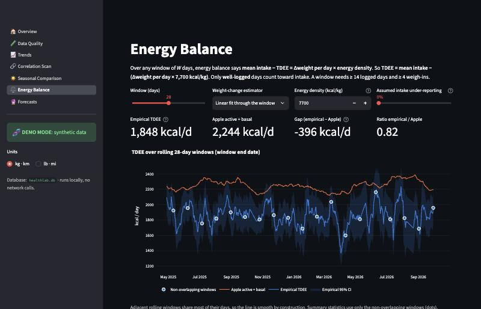
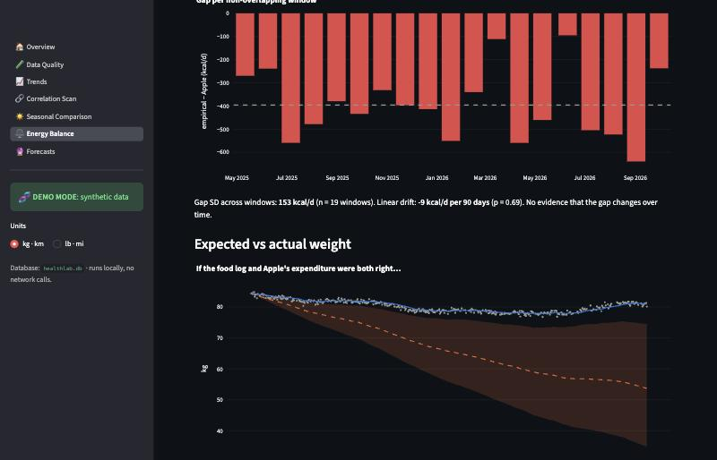

# HealthLab

**Local-first statistical analysis of an Apple Health export**: streaming ingest into SQLite, a recomputable
daily rollup with data-quality controls, and a Streamlit app for trends, a multiple-testing-corrected lagged
correlation scan, seasonal comparisons, an energy-balance model and honestly-evaluated forecasts.

Every methodological judgment call is logged with its rationale in **[DECISIONS.md](DECISIONS.md)**.

```bash
pip install -e . && healthlab demo      # synthetic data end to end, opens the app at http://127.0.0.1:8501
```

---

## What it finds

### On synthetic data with planted ground truth (demo mode)

`healthlab synth` generates 18 months of iPhone-style data with known effects baked in. The test suite
(`tests/test_e2e_synth.py`) requires the full pipeline to recover them:

| Planted effect | Truth | Recovered by the app |
|---|---|---|
| Steps today → walking speed **tomorrow** | lag 1, positive | Strongest at **lag 1**, ρ = 0.50 (lag 0: 0.14, lag 3: 0.04), q < 10⁻³⁰ |
| Active energy today → food intake **in 2 days** | lag 2, positive | Strongest at **lag 2**, ρ = 0.42, q < 10⁻¹⁰ |
| True TDEE | 2,140 kcal/d | **2,167** kcal/d after the 15% under-reporting adjustment. Naive estimate 1,848 (the bias is visible) |
| Apple's active + basal estimate | 2,248 kcal/d | 2,244 kcal/d. Gap to empirical TDEE −396 kcal/d (95% CI −470 to −322), stable over time (drift p = 0.69) |
| Summers in Bulgaria: +35% steps | +35% | Median +2,312 steps/day, 7-day block-bootstrap 95% CI [1,448, 3,064], Cliff's δ = 0.47 |
| Logging coverage | ~70% of days complete | 67% flagged well-logged, 14% partial. Unlogged days are missing, never zero |
| Duplicate energy from a second app | must not double count | Source priority keeps one source per day (mean active energy within 4% of truth) |

Methodological checks the demo makes visible:

- **Detrending matters.** On raw daily series the same scan "discovers" 266 of 735 tests. After rolling-median
  detrending and the effective-n correction, it finds 114, and the planted effects stay at the top.
- **If you believed both the food log and Apple's expenditure**, the predicted weight path would diverge from
  the real one by about 384 kcal/day. With ±8% uncertainty in Apple's estimate compounded over 18 months, the
  plausible band spans ±13 kg. Small systematic errors dominate long-run energy-balance predictions.
- **Forecasts versus baselines** (12 weekly folds): SARIMAX beats seasonal-naive by 19% MAE on daily steps and
  beats naive by 25% on the weight trend. Gradient boosting helps for steps, but is **worse than naive** on the
  weight trend, because trees can't extrapolate a trend. The app reports that rather than hiding it.

| | |
|---|---|
|  |  |
|  |  |
|  |  |

*All screenshots show synthetic demo data.*

### Using your own data

Run `healthlab ingest` on your own export (see Setup) and the same pages work on it. Your data never leaves
your machine, and `.gitignore` keeps it out of version control. Real results are deliberately not included here.

---

## Methodology summary

**Ingest** ([`ingest.py`](src/healthlab/ingest.py))
- `iterparse` straight from the zip with element clearing (~45 MB peak RSS for a ~260 MB XML), batched
  `INSERT OR IGNORE`.
- Every `Record` type is stored generically (nothing hardcoded). Timestamps are stored as UTC plus the offset
  as written.
- A content hash over normalised fields makes re-imports idempotent and incremental, even when a later export
  renders the same samples with a different UTC offset.

**Time zones** (DECISIONS T1–T3)
- Apple re-renders every timestamp in the phone's offset *at export time*. A US-Pacific export says `-0700` everywhere,
  including summers in Bulgaria, so local dates are computed in `America/Los_Angeles` (DST-aware).
- The resulting summer misalignment is a documented, visible limitation: the Data Quality page shows
  activity timing by hour, and travel appears as a shifted band.

**Daily rollup** ([`rollup.py`](src/healthlab/rollup.py))
- One config mapping sets each type's aggregation: sum, mean, last, LAeq for audio, count, or sleep (assigned
  to the wake date).
- Units are normalised to metric. Cumulative samples are prorated across midnight.
- Per-day source priority stops iPhone + app double counting.
- No data means NaN, not 0. The exception is event-style counts on days the phone was demonstrably carried.

**Nutrition coverage** (N1–N4)
- `well_logged` = ≥ 3 entries and 1,200–5,000 kcal. Every nutrition analysis is masked to well-logged days
  at a single choke point, `load_daily()`.

**Correlation scan** ([`correlations.py`](src/healthlab/analysis/correlations.py), C1–C11)
- Spearman ρ for all metric pairs at lags 0–3, run on detrended series (residual from a 28-day rolling median)
  or first differences.
- A Bartlett effective-n correction handles leftover autocorrelation, and Benjamini–Hochberg FDR runs across
  every test.
- Mechanical pairs, including the iPhone basal-energy artifact, are flagged. So are differencing-induced lag-1
  artifacts.
- It generates hypotheses, not causal claims, and the UI says so.

**Seasonal comparison** ([`seasonal.py`](src/healthlab/analysis/seasonal.py), S1–S8)
- Config-defined periods (several date ranges per label) are compared with Mann–Whitney U and Cliff's δ.
- Bootstrap CIs for the median difference come in both iid and 7-day moving-block form; the block version is
  honest under autocorrelation.
- A weekly-unit sensitivity check and an explicit confounds panel complete the page.

**Energy balance** ([`energy.py`](src/healthlab/analysis/energy.py), E1–E9)
- TDEE = mean well-logged intake − weight slope × 7,700 kcal/kg over 28-day windows. The weight slope defaults
  to a window OLS fit; the EWMA-trend difference is an option.
- CIs propagate both intake and slope uncertainty, and summaries use non-overlapping windows only.
- The page compares the result with Apple's estimate (gap, SD, drift test), runs a Monte Carlo expected-weight
  trajectory, and includes an under-reporting sensitivity slider and discussion.

**Forecasting** ([`forecast.py`](src/healthlab/analysis/forecast.py), F1–F7)
- Naive and seasonal-naive baselines compete with SARIMAX(1,0,1)(1,0,1,7) and a direct multi-horizon
  HistGradientBoosting model with leakage-safe lag features.
- Evaluation is a `TimeSeriesSplit` rolling origin, with MAE, skill and fold-win counts reported honestly.

---

## Setup

Requires Python 3.11+.

```bash
python3 -m venv .venv && source .venv/bin/activate
pip install -e ".[dev]"
```

**Demo mode** (synthetic data, safe to share screenshots of):

```bash
healthlab demo
```

**Your own data:**
1. On iPhone: Health → profile → *Export All Health Data*.
2. Put the zip at `data/raw/export.zip`. The whole `data/` folder is gitignored.

```bash
healthlab ingest data/raw/export.zip      # stream-parse, dedup, rebuild the daily table
```

```bash
healthlab app                             # http://127.0.0.1:8501
```

Re-run `ingest` with newer exports at any time: only new samples are inserted. `healthlab rollup` recomputes
the daily table after you change aggregation rules or thresholds in `config/healthlab.yaml`.

**Demo mode switch:** `DEMO_MODE=1` (or `demo_mode: true` in the config) points every command and the app at
`data/demo/healthlab.db` instead of the real database.

**Tests:**

```bash
pytest
```

85 tests cover parsing, timezone edge cases, duplicate imports, aggregation rules, logging coverage,
BH correction, the stats primitives, the forecasting leakage guard, and the synthetic end-to-end run (~10 s).

### Configure your periods

Fill in your actual Bulgaria dates in `config/healthlab.yaml` → `seasonal.periods`. Until then, the Seasonal
page compares calendar months.

### Privacy

- `data/` (raw export, database, synthetic data) is gitignored, as are `*.zip`, `*.xml`, `*.db` and `*.csv`
  anywhere in the repo.
- The app makes **no network calls** with health data. Streamlit binds to `127.0.0.1` with usage statistics off.

### Troubleshooting: `ModuleNotFoundError: No module named 'healthlab'` on macOS

If the project lives in an iCloud-synced folder (Desktop/Documents), macOS can set the `hidden` flag on
files inside `.venv`. Python ≥ 3.14 then silently skips the editable install's `.pth` file. Fix it with
`chflags nohidden .venv/lib/python*/site-packages/__editable__*.pth`, or create the venv outside iCloud, or
prefix commands with `PYTHONPATH=src`. `healthlab app` / `healthlab demo` set `PYTHONPATH` for the Streamlit
process automatically.

## Project layout

```
config/healthlab.yaml          all parameters (aggregation rules, thresholds, periods, model settings)
src/healthlab/
  ingest.py  rollup.py  quality.py  units.py  timeutil.py  db.py  config.py  cli.py  synth.py
  analysis/  correlations.py  seasonal.py  energy.py  forecast.py  stats.py  trend.py
  app/       main.py  common.py  views/{overview,data_quality,trends,correlations,seasonal,energy,forecasts}.py
tests/                         unit + end-to-end tests
DECISIONS.md                   every methodology assumption, with rationale
```
