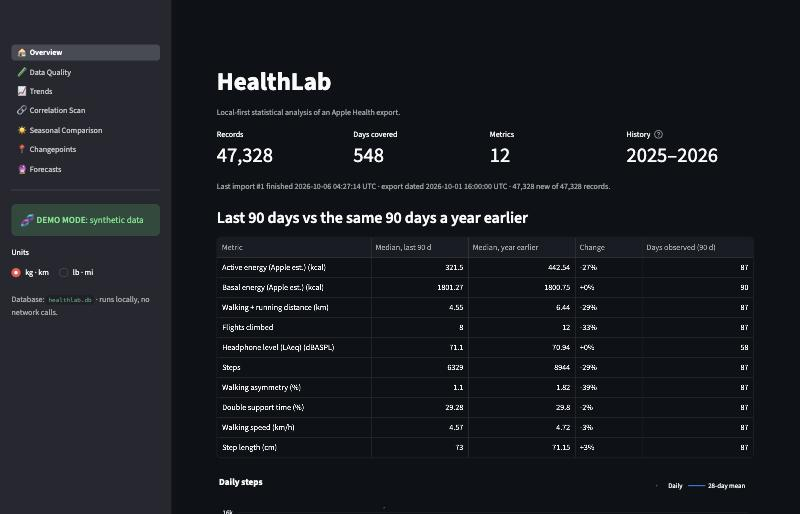
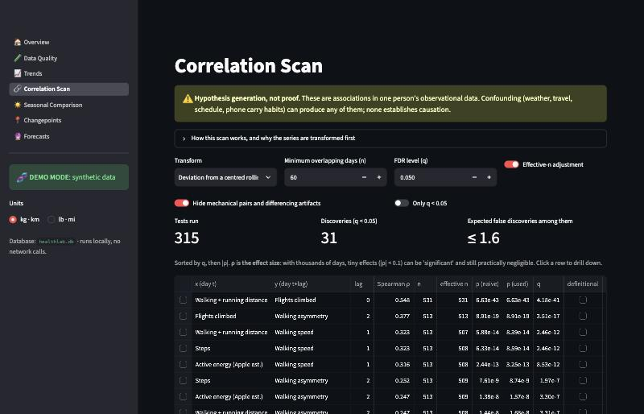
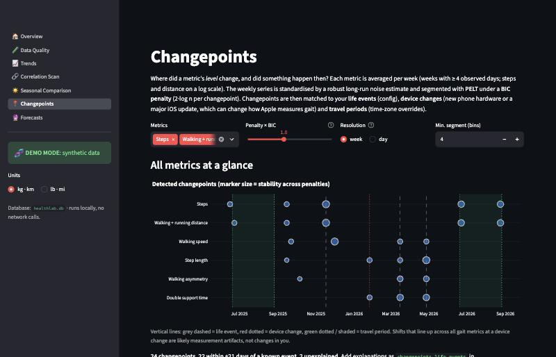
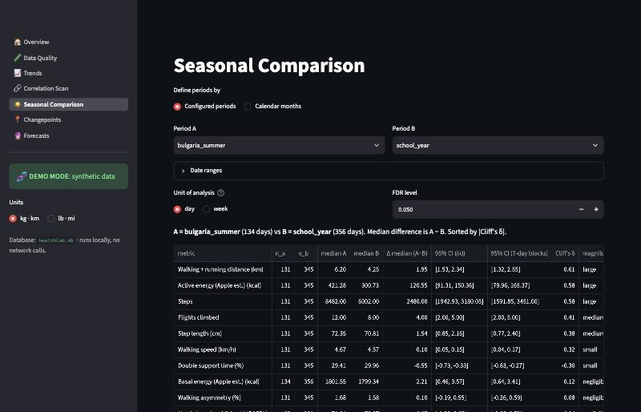
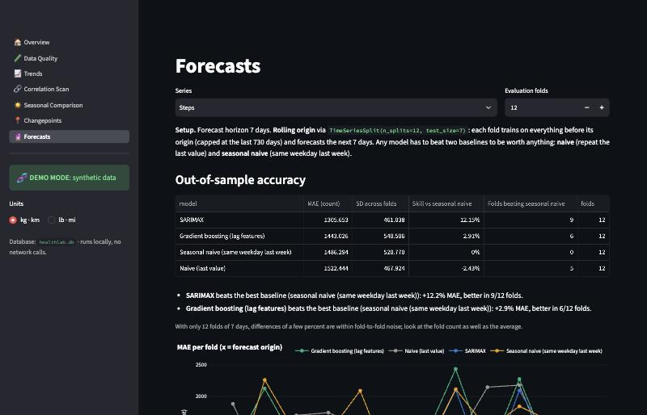

# HealthLab

**Local-first statistical analysis of an Apple Health export**: streaming ingest into SQLite, a recomputable
daily rollup with data-quality controls, and a Streamlit app for trends, a multiple-testing-corrected lagged
correlation scan, seasonal comparisons, changepoint detection with life-event annotation, and
honestly-evaluated forecasts.

Every methodological judgment call is logged with its rationale in **[DECISIONS.md](DECISIONS.md)**.

```bash
pip install -e . && healthlab demo      # synthetic data end to end, opens the app at http://127.0.0.1:8501
```

---

## What it finds

### On synthetic data with planted ground truth (demo mode)

`healthlab synth` generates 18 months of iPhone-style data with known effects baked in. The test suite
(`tests/test_e2e_synth.py`) requires the full pipeline to recover them:

| Planted effect | Truth | Recovered by the app |
|---|---|---|
| Steps today → walking speed **tomorrow** | lag 1, positive | Strongest at **lag 1**, ρ = 0.32 (lags 0/2/3: ≤ 0.06), q ≈ 10⁻¹² |
| Flights climbed today → walking asymmetry **in 2 days** | lag 2, positive | Strongest at **lag 2**, ρ = 0.38 (other lags ≤ 0.06), q ≈ 10⁻¹⁷ |
| 20 regime shifts across 6 metrics (summers, a −30% car commute, a 6-week injury, a phone upgrade that changes *measured* gait) | dates | **All 20 found** by PELT at the BIC penalty: 12 in the exact week, 6 within 2–4 days, 2 twenty days late. 22 of 24 detections match a known life, device or travel event. BOCPD independently agrees |
| Commute regime | −30% steps | −27% median steps after the changepoint, block-bootstrap CI excludes 0, Cliff's δ = −0.64 |
| Summers lived in Sofia time | daily totals | Exact with the `Europe/Sofia` override (median error < 1%). Without it, summer days are wrong by 8% (median) and > 20% on many days |
| Summers in Bulgaria vs school year | +35% steps (plus the commute) | Median +2,480 steps/day, 7-day block-bootstrap 95% CI [1,592, 3,451], Cliff's δ = 0.58 |
| A partner's phone writing steps on days the demo phone has no data | must be excluded | `source_exclude` removes it, so those days stay missing instead of showing someone else's steps |
| Duplicate energy from a second app | must not double count | Source priority keeps one source per day (mean active energy within 3% of truth) |

Methodological checks the demo makes visible:

- **Detrending matters.** On raw daily series the same scan "discovers" 112 of 315 tests. After rolling-median
  detrending and the effective-n correction, it finds 31, and both planted effects are at the top.
- **Autocorrelation and changepoints.** On 300 days of pure AR(1) noise (φ = 0.7), BIC segmentation scaled by
  the ordinary noise SD finds ~8 spurious changepoints per series. Scaling by the long-run SD cuts that to ~2
  (unit-tested). Shrinking φ to its lower confidence bound keeps short weekly series from losing real shifts.
- **Forecasts versus baselines** (12 weekly folds): SARIMAX beats seasonal-naive by 12% MAE on daily steps
  (better in 9/12 folds) and by 26% on walking speed (11/12). Gradient boosting barely beats the baseline for
  steps (+3%, 6/12 folds), and the app says so.

| | |
|---|---|
|  |  |
|  |  |
|  | |

*All screenshots show synthetic demo data.*

### Using your own data

Run `healthlab ingest` on your own export (see Setup) and the same pages work on it. Your data never leaves
your machine, and `.gitignore` keeps it out of version control. Real results are deliberately not included here.

---

## Methodology summary

**Ingest** ([`ingest.py`](src/healthlab/ingest.py))
- `iterparse` straight from the zip with element clearing (~45 MB peak RSS for a ~260 MB XML), batched
  `INSERT OR IGNORE`.
- Every `Record` type is stored generically (nothing hardcoded). Timestamps are stored as UTC plus the offset
  as written.
- A content hash over normalised fields makes re-imports idempotent and incremental, even when a later export
  renders the same samples with a different UTC offset.

**Time zones** (DECISIONS T1–T3)
- Apple re-renders every timestamp in the phone's offset *at export time*. A US-Pacific export says `-0700` everywhere,
  including summers in Bulgaria, so the original offsets are lost.
- Local dates are computed from the UTC instant in `America/Los_Angeles` (DST-aware) by default, and in the
  configured zone inside **override periods** (e.g. `Europe/Sofia` for each summer). Labelled overrides double
  as seasonal-comparison periods.
- The Data Quality page's activity-by-hour heatmap shows any travel not covered by an override as a shifted band.

**Daily rollup** ([`rollup.py`](src/healthlab/rollup.py))
- One config mapping sets each type's aggregation: sum, mean, last, LAeq for audio, count, or sleep (assigned
  to the wake date).
- Units are normalised to metric. Cumulative samples are prorated across midnight.
- Per-day source priority stops iPhone + app double counting.
- No data means NaN, not 0. The exception is event-style counts on days the phone was demonstrably carried.

**Sources & devices** (R3a, R3b)
- Specific sources (e.g. a family member's phone) can be excluded in config, globally or per type.
- The Data Quality page shows each source's active date range and the hardware models parsed from Apple's
  device strings, so you can verify which sources are yours.

**Correlation scan** ([`correlations.py`](src/healthlab/analysis/correlations.py), C1–C11)
- Spearman ρ for all metric pairs at lags 0–3, run on detrended series (residual from a 28-day rolling median)
  or first differences.
- A Bartlett effective-n correction handles leftover autocorrelation, and Benjamini–Hochberg FDR runs across
  every test.
- Mechanical pairs, including the iPhone basal-energy artifact, are flagged. So are differencing-induced lag-1
  artifacts.
- It generates hypotheses, not causal claims, and the UI says so.

**Seasonal comparison** ([`seasonal.py`](src/healthlab/analysis/seasonal.py), S1–S8)
- Config-defined periods (several date ranges per label) are compared with Mann–Whitney U and Cliff's δ.
- Bootstrap CIs for the median difference come in both iid and 7-day moving-block form; the block version is
  honest under autocorrelation.
- A weekly-unit sensitivity check and an explicit confounds panel complete the page.

**Changepoints** ([`changepoints.py`](src/healthlab/analysis/changepoints.py), K1–K12)
- Weekly means (steps and distance on a log scale) of steps, distance and four walking metrics are standardised
  by a robust long-run noise SD (AR(1) from first differences, φ shrunk to its lower 95% bound) and winsorised.
- They're segmented with **PELT** (`ruptures`) under a **BIC penalty** of 2·log n, with a sensitivity sweep
  (0.25×–8×) and per-changepoint stability.
- **Bayesian online changepoint detection** (Adams & MacKay) runs as an independent comparison.
- Before/after effect sizes on daily values come with block-bootstrap CIs.
- Changepoints are matched to configured **life events**, **device changes** (new hardware or a major iOS
  version) and **travel periods**.

**Forecasting** ([`forecast.py`](src/healthlab/analysis/forecast.py), F1–F7)
- Naive and seasonal-naive baselines compete with SARIMAX(1,0,1)(1,0,1,7) and a direct multi-horizon
  HistGradientBoosting model with leakage-safe lag features.
- Evaluation is a `TimeSeriesSplit` rolling origin, with MAE, skill and fold-win counts reported honestly.

---

## Setup

Requires Python 3.11+.

```bash
python3 -m venv .venv && source .venv/bin/activate
pip install -e ".[dev]"
```

**Demo mode** (synthetic data, safe to share screenshots of):

```bash
healthlab demo
```

**Your own data:**
1. On iPhone: Health → profile → *Export All Health Data*.
2. Put the zip at `data/raw/export.zip`. The whole `data/` folder is gitignored.

```bash
healthlab ingest data/raw/export.zip      # stream-parse, dedup, rebuild the daily table
```

```bash
healthlab app                             # http://127.0.0.1:8501
```

Re-run `ingest` with newer exports at any time: only new samples are inserted. `healthlab rollup` recomputes
the daily table after you change aggregation rules or thresholds in `config/healthlab.yaml`.

**Demo mode switch:** `DEMO_MODE=1` (or `demo_mode: true` in the config) points every command and the app at
`data/demo/healthlab.db` instead of the real database.

**Tests:**

```bash
pytest
```

94 tests cover:
- parsing, timezone edge cases (including override periods) and duplicate imports;
- aggregation rules and source exclusion;
- BH correction and the stats primitives;
- the changepoint estimators and the forecasting leakage guard;
- the synthetic end-to-end run, which checks recovery of every planted effect (~30 s).

### Configure your travel periods

Add each stay abroad to `config/healthlab.yaml` → `time.overrides`, for example
`{start: "2025-06-18", end: "2025-08-28", timezone: Europe/Sofia, label: bulgaria_summer}`, then run
`healthlab rollup`. The label also makes it a period on the Seasonal page; add `school_year` ranges under
`seasonal.periods`. Until two periods exist, the Seasonal page compares calendar months.

### Annotate changepoints with life events

Add `{date: "2024-09-01", label: "Started university"}` entries under `changepoints.life_events`. Device changes
(new phone, major iOS update) and travel periods are added automatically.

### Exclude sources that aren't yours

List them under `source_exclude.all` (or per HealthKit type), then run `healthlab rollup`.

### Privacy

- `data/` (raw export, database, synthetic data) is gitignored, as are `*.zip`, `*.xml`, `*.db` and `*.csv`
  anywhere in the repo.
- The app makes **no network calls** with health data. Streamlit binds to `127.0.0.1` with usage statistics off.

### Troubleshooting: `ModuleNotFoundError: No module named 'healthlab'` on macOS

If the project lives in an iCloud-synced folder (Desktop/Documents), macOS can set the `hidden` flag on
files inside `.venv`. Python ≥ 3.14 then silently skips the editable install's `.pth` file. Fix it with
`chflags nohidden .venv/lib/python*/site-packages/__editable__*.pth`, or create the venv outside iCloud, or
prefix commands with `PYTHONPATH=src`. `healthlab app` / `healthlab demo` set `PYTHONPATH` for the Streamlit
process automatically.

## Project layout

```
config/healthlab.yaml          all parameters (aggregation rules, thresholds, periods, model settings)
src/healthlab/
  ingest.py  rollup.py  quality.py  units.py  timeutil.py  db.py  config.py  cli.py  synth.py
  analysis/  correlations.py  seasonal.py  changepoints.py  forecast.py  stats.py  trend.py
  app/       main.py  common.py  views/{overview,data_quality,trends,correlations,seasonal,changepoints,forecasts}.py
tests/                         unit + end-to-end tests
DECISIONS.md                   every methodology assumption, with rationale
```
